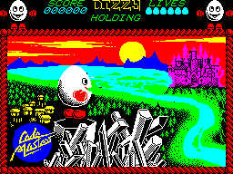
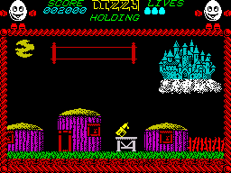
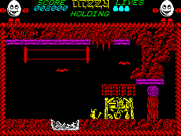
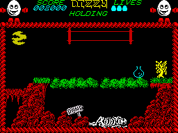

# Dizzy — The Ultimate Cartoon Adventure

**[Play in your browser](https://gagarinbefree.github.io/Dizzy/)** · **[Download for Windows or Android](https://github.com/gagarinbefree/Dizzy/releases/latest)**

[](https://gagarinbefree.github.io/Dizzy/)

Dizzy went into the Haunted Forest to pick berries. He came home with a much stranger find. Under the dirt on a stone slab was a recipe his Eggfather once told him about. Brew it properly and it can put an end to the wizard Zaks. With any luck, the Yolkfolk might even get a dry Sunday for cricket.

This is a Godot port of the Oliver Twins’ 1987 single-player adventure for the 48K ZX Spectrum. Press **Space** or **Enter** on the title screen to start.

## The recipe on the stone

The **Avawifforce Potion** calls for a leprechaun’s wig, the silver lining of a cloud, a feather from a Vampire Dux, and a measure of troll brew. Somewhere between the village and the castle, you’ll have to get your hands on all four.

You start beside the cauldron. Find a way to light the fire beneath it, then bring the ingredients back as you find them. Remember where you leave your tools. An object that seems useless in the forest might be just what you need down a mine.

| The Village of Cigam | The Deserted Diamond Mines | The Haunted Forest |
|:---:|:---:|:---:|
|  |  |  |

**A tip from the cassette.** If a ledge seems just out of reach, try jumping from a mushroom. Keep an eye out for eggs along the way. Each one gives Dizzy another life. [Original cassette instructions](https://worldofspectrum.net/pub/sinclair/games-info/d/Dizzy.txt)

## Controls

| Action | Keys |
| --- | --- |
| Start the adventure | **Space** or **Enter** |
| Walk left / right | **Z / X** or **← / →** |
| Jump | **Space** or **↑** |
| Pick up, drop or use an item | **Enter** |
| Pause / resume | **P** |
| Return to the title screen | **Q** |
| Start a new game | **F5** |

**Windows** — Unzip the whole download and open `Dizzy.exe`. **Android** — Install the APK and connect a physical keyboard to play. The game data and music are included on every platform. [Latest downloads](https://github.com/gagarinbefree/Dizzy/releases/latest)

## The Spectrum artwork

Browse 200 sprites and 78 character frames, or open a room to see its original 256 × 192 pixels. The room gallery keeps the Spectrum table numbers, including the title screen at 000 and the starting room at 074. Each room also has a downloadable Spectrum screen file. [Sprite gallery](https://gagarinbefree.github.io/Dizzy/gallery/gallery.html) · [Room gallery](https://gagarinbefree.github.io/Dizzy/gallery/locations/)

## Original game

The Oliver Twins created *Dizzy*. Code Masters Ltd published the 48K Spectrum edition in 1987 for £1.99. The in-game credits name James Wilson for graphics and David Whittaker for music. The cassette instructions supplied the story and recipe above. [World of Spectrum archive and cassette inlay](https://worldofspectrum.org/archive/software/games/dizzy-code-masters-ltd) · [Instructions transcript](https://worldofspectrum.net/pub/sinclair/games-info/d/Dizzy.txt)

## Build from source

On Windows x64, open PowerShell in the folder containing `project.godot`. Install the .NET 10 SDK and start the game with this command.

```powershell
./run.ps1
```

The launcher uses Godot 4.7.2 .NET and downloads a verified copy into `.tools/` if needed. To use your own installation, pass `-GodotPath` with the path to its executable. All game code, graphics, room data and audio come with this checkout.

To build the Windows release, install Python 3 and run `./run.ps1 -ExportWindows`. The executable and its companion files land in `build/windows/`. To check startup and play through 240 game ticks without opening a window, run `./run.ps1 -SmokeTest`. GitHub Actions also builds the web version and signs the Android APK. [Build workflow](.github/workflows/web.yml)
